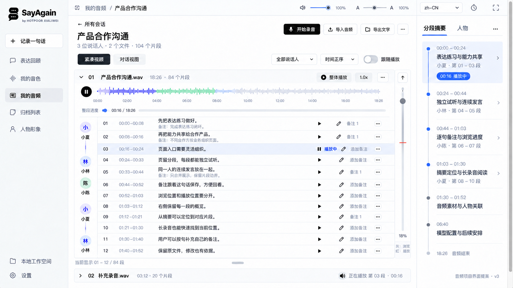

# SayAgain 音频项目界面效果图 v3



2026-10-11，根据用户对[前一版](sayagain-product-overview-audio-v2.md)「尺寸太大、右侧分段总结与滚条进度缺失」的反馈，使用内置 `image_gen` 重新制作单独的桌面音频工作区效果图，随后修正尺寸、时间、播放状态和备注摘要。成图 1672 × 941 px。

本次交付是**界面设计提案**；没有修改运行中的 Electron 或 iOS 客户端。

## 本版组织

- 单独展示音频页面，取消宣传海报中的设备外壳和大标题区域，便于检查桌面阅读密度。
- 一屏显示 12 个独立片段；同一人物连续发言共享身份栏，每段保留编号、起止时间、播放、校对与备注入口。第 01、02、05 段显示已写备注摘要；原文和备注分开。
- 右侧恢复「分段摘要」时间线，用人物、时间范围和片段编号联系正文，并显示当前播放所在分组。
- 正文右侧保留单独的纵向导航轨：灰色浏览滑块、红色播放位置线、浏览百分比及回顶按钮。浏览位置与播放位置分别表达；本图关闭跟随播放。
- 文件波形下有独立整段进度；正文下有可见范围「01–12 / 84 段」与高度把手；第二份音频保持折叠。

## 现有能力与拟议部分

文件分组、时间范围、独立试听、紧凑视图下的连续人物身份栏、纵向浏览滑块、红色播放位置线、百分比、可见范围及列表高度调节已有实现。

**右侧内容摘要和独立逐句备注为拟议交互。** 现有「文字与笔记」更新片段的转写字段，不等同于独立备注数据；当前文件解析也没有实现语义摘要。本图不声称这些能力已上线。未来实现时应为摘要与备注保留明确片段引用，并支持定位；原始转写和原音频继续分别保存。

图中人物、片段文字、时长、数量、备注、摘要与波形均为演示内容，不作为真实模型推理证据。生成图片的小字仍需在代码实现时使用准确文本，不能直接作为产品文案来源。

## 参考

- [上一版效果图](sayagain-product-overview-audio-v2.png)
- 当前桌面音频 UI 的本地测试截图 `test-results/chat/desktop.png`（未纳入 Git 的测试产物）。
- 用户提供的原始 SayAgain 参考图：右侧时间锚点与摘要结构。
- [现有录音界面和滚动、播放状态逻辑](../../renderer/recordings.js)
- [现有样式](../../renderer/styles.css)

## 基础生成提示词

```text
Use case: ui-mockup.
Create one revised SayAgain AUDIO PROJECT product UI effect image. The user rejected previous posters because the UI remains too large and because the RIGHT SEGMENT SUMMARY and VERTICAL SCROLL/PLAYBACK PROGRESS were lost. Correct these three issues clearly. This is a focused high-fidelity full desktop app view, shown straight-on at realistic desktop density, NOT a marketing poster.

Input references:
1. Previous generated poster: preserve its real SayAgain branding, restrained black-white/light-gray palette, independent segment rows, shared same-speaker identity rails and segment annotations. Its large control sizes are the problem to FIX.
2. Actual running desktop screenshot: PRIMARY REFERENCE for typography size and realistic desktop content density, thin separators, a real vertical browsing rail and audio seek bar.
3. Original user poster: only reference for the right-hand time-anchored segment summary panel; do not copy its logo, marketing headline or unrelated meeting features.

Canvas: landscape 16:9, ideally 1920x1080, a single complete desktop app window filling the image. Remove laptop hardware, phone, promotional headline, glossy backdrop and large feature list so we can inspect the audio workspace itself. Flat crisp UI, entirely readable, no perspective. White content, very pale gray left sidebar, thin gray dividers, modest black buttons, subtle slate-blue/purple accents. Proper Chinese sans-serif UI font. Normal desktop scale, visibly much denser than the last poster. Do not make a presentation slide with massive typography.

Strict geometry at a 1440x900 equivalent scale:
- Left app navigation 160–175px wide, body text 12–13px, SayAgain brand text 18px and real two-speech-bubble icon 24px. Tiny creator credit "by HOTPOOR XIALIWEI".
- Main audio area 1000px including right column; right segment-summary column 220–235px wide. Main margins 18px.
- Page title ONLY 18–20px, regular bold. Buttons ONLY 26–28px tall. Avatars ONLY 22–24px. Most horizontal/vertical gaps 6–10px.
- Topbar, page header, filter, file header and waveform together take no more than 220px height.
- At least TEN independently readable audio segment rows above the fold, row height about 42–48px; one shallow expanded note editor about 45–55px.
- No large rounded speech bubbles, no 40px+ avatars, no oversized headings, no giant blank cards, no thick framing, no promotional text.

Layout:
Slim top application bar with breadcrumb "我的音频 / 产品合作沟通", small audio-volume and text-size controls showing "100%"; no provider name needed.
Navigation entries "表达回顾", "我的音色", "我的音频" selected, "归档列表", "人物形象". Small outlined "记录一句话". Bottom "本地工作空间" and "设置".
Compact workspace header: back link "所有会话", title "产品合作沟通", metadata "3 位说话人 · 2 个文件 · 104 个片段". Right SMALL buttons "开始录音", "导入音频", "导出文字".
A 28px filter row: "紧凑视图" selected, "对话视图"; "全部说话人", "时间正序", "跟随播放" small opt-in control.
Main file header "01  产品合作沟通.wav" with collapse chevron, "18:26 · 84 个片段", tiny "整体播放". Shallow speaker-colored waveform about 34px high with small tick labels. A distinct horizontal seek track below labelled "整段进度 00:16 / 18:26". Keep waveform and whole-file progress separate.

Main transcript: compact aligned open rows, NOT chat bubbles. Columns are narrow shared speaker identity, segment index/time, spoken text, tiny row actions. Consecutive same-speaker rows share ONE avatar and name in a left rail with subtle vertical connecting line, while each individual segment retains boundaries and independent actions.
Display:
First run "小夏" ONE avatar across segments 01,02,03:
"01  00:00–00:08" / "先把表达练习做好。" / tiny play, pencil, "备注 1"; a small muted annotation line "备注：完成表达练习闭环。"
"02  00:08–00:16" / "再把能力共享给合作产品。" / tiny play, pencil, "备注 1".
Under ONLY segment 02 show a shallow inline note editor "第02段备注", input "不同合作方按业务组织页面。", tiny "保存" and "取消". Preserve spoken text above, note below.
"03  00:16–00:24" / "页面入口需要灵活组织。" / tiny pause, pencil, "添加备注". This is currently playing: a subtle pale blue row highlight and small "播放中".
Next run "小林" ONE avatar across 04,05:
"04  00:24–00:33" / "保留分段，每段都能独立试听。" / tiny play, pencil, "添加备注".
"05  00:33–00:44" / "同一人的连续发言放在一起。" / tiny play, pencil, "备注 1".
Next run "小陈" ONE avatar across 06,07:
"06  00:44–00:52" / "备注跟着这句话保存，方便回看。" / tiny play, pencil, "添加备注".
"07  00:52–01:03" / "浏览位置和播放位置要分开。" / tiny play, pencil, "添加备注".
Next run "小夏" ONE avatar across 08,09,10:
"08  01:03–01:12" / "右侧保留每一段的概览。" / tiny play, pencil, "添加备注".
"09  01:12–01:21" / "从摘要可以定位到对应片段。" / tiny play, pencil, "备注 1".
"10  01:21–01:30" / "长录音也能快速找到当前位置。" / tiny play, pencil, "添加备注".
Between rows use hairline separators, timing 10–11px-equivalent muted gray, spoken text 12–13px-equivalent dark gray. No duplicate enormous identity at every row.

MANDATORY REAL VERTICAL NAVIGATION next to the transcript, separate from the summary:
A visible 30–34px narrow vertical navigation rail on the transcript right edge. A small up-arrow button at top, a long light-gray vertical track, a dark-gray draggable circular browsing thumb at around 18% of the rail, a separate thin RED horizontal playback marker aligned with the playing segment row, and small "18%" at bottom. Small legend "灰：浏览 · 红：播放". The gray browsing thumb and red playback marker MUST BOTH be clearly visible. Also show a thin native outer scrollbar at the far right of the full application window.
A compact transcript footer under the scroll viewport: "当前显示 01–10 / 84 段" and a small centered horizontal drag grip indicating adjustable list height. A second collapsed file header below "02  补充录音.wav   03:12 · 20 个片段". Footer playback status "正在播放 第03段 · 00:16".

MANDATORY RIGHT COLUMN — SEGMENT SUMMARIES:
Title "分段摘要", with small alternate tab "人物". This column is a vertical time-anchor timeline, NOT a speaker-only empty card.
Small circular nodes on a fine gray/blue vertical line, start/end labels and concise summaries. At least six entries:
"00:00–00:24" / "表达练习与能力共享" / "小夏 · 第01–03段"
"00:24–00:44" / "独立试听与连续发言" / "小林 · 第04–05段"
"00:44–01:03" / "逐句备注与浏览进度" / "小陈 · 第06–07段"
"01:03–01:30" / "摘要定位与长录音阅读" / "小夏 · 第08–10段"
"02:15" / "音频素材与人物关联"
"06:40" / "模型配置与后续安排"
The first summary anchor has a delicate pale blue highlight and a small RED or indigo timestamp badge "00:16 播放中". Include subtle chevrons to imply jump-to-segment. Below timeline a compact row "18:26 音频结束". The right summary should resemble the original reference's time-anchored outline but with OUR audio segments, not unrelated fabricated meeting decisions.
At bottom very small "音频项目界面提案 · v3".
Keep brand invariant real black two-speech-bubble SayAgain icon, each with three white dots. No new logos. Correct Chinese and English spelling. The result must clearly show COMPACT UI + TEN SEGMENTS + SHARED SPEAKER GROUPS + SENTENCE NOTE + RIGHT SEGMENT SUMMARY + BOTH VERTICAL PROGRESS INDICATORS in one full desktop view.
```

## 尺寸与状态修正提示词

```text
Edit the supplied full SayAgain audio-workspace UI image. Keep ALL essential features and the three-column full desktop layout: existing logo and creator credit, grouped speaker identity, independently numbered clips, the inline note editor, the right-hand time-anchored "分段摘要", the clearly visible custom vertical rail with BOTH gray browsing thumb and separate red playback marker, the bottom visible-range status and second audio-file header. Do NOT omit or replace any of these.

This is a precise compactness and correctness refinement:
1. The user still wants visibly smaller control sizes. At the supplied 1672x941 image resolution, shrink UI typography and controls by a further 20%. Target page title about 20px, main body text about 13px, navigation text about 14px, small timestamp text 11–12px, avatar diameter 24–28px (the existing roughly 40px avatars are too big), button height 26–28px. Keep Chinese crisp, readable and not distorted.
2. Narrow the LEFT navigation from about 238px to 180px. Preserve all entries and brand. Right summary panel remains around 245px; use the gained width for transcript content. Do not shrink the entire screenshot into a smaller framed image, and do not add a promotional poster.
3. Compress the page header/filter rows vertically and keep the waveform shallow. Use the freed space to show TWO additional short audio-segment rows, reaching TWELVE visible rows. Main transcript row text is single line wherever possible, modest compact notes beneath only rows that have notes. Keep first speaker 小夏 across 01–03, 小林 across 04–05, 小陈 across 06–07, 小夏 across 08–10; add 小林 once across new 11–12. Preserve every original row's content and timing EXCEPT the error below.
New rows:
"11  01:30–01:40" / "用户可以按句补充自己的备注。" / tiny play, pencil, "添加备注".
"12  01:40–01:52" / "保留原文件，修改也有依据。" / tiny play, pencil, "添加备注".
Update the bottom visible-range text to exact "当前显示 01–12 / 84 段".
4. Correct the mistaken row 06 time range to exact "00:44–00:52" (not 00:44–00:32). All timestamp starts must precede ends.
5. Turn "跟随播放" OFF: a light gray switch with its knob on the LEFT. Preserve gray browse-thumb and red playback-marker at separate heights; the off state accurately shows that browsing and playback can be independent. Keep right summary highlight "00:16 播放中", selected current transcript row 03, and the distinct gray browsing thumb / red playback line.
6. Ensure right summary third heading reads exact "逐句备注与浏览进度". Do not turn the right summary into a speaker list.
Keep all other data and styling as close as possible to the supplied image. End result is a dense, refined professional desktop audio workbench, not a spacious mobile interface. Entire application visible and full canvas used, no computer hardware or phone.
```

## 备注摘要修正提示词

```text
Make ONLY these small local text-detail edits to the supplied compact SayAgain audio UI. Preserve the entire existing geometry, all twelve numbered rows, realistic small typography, right-hand segment-summary timeline, gray browsing thumb, red playback position line, off-state follow toggle, two file headers, logo and creator credit.

1. In transcript row 01, directly below the spoken sentence "先把表达练习做好。" add a tiny secondary muted gray annotation line "备注：完成表达练习闭环。". Fit within the current compact row by raising its existing spoken line slightly. Do not increase the row height.
2. In transcript row 02, directly below "再把能力共享给合作产品。" add a tiny secondary muted gray line "备注：不同合作方按业务组织页面。". Fit in the current row height. This is an annotation distinct from recognized speech. Keep its "备注 1" row action.
3. In row 05, directly below "同一人的连续发言放在一起。" add the tiny muted gray line "备注：只合并展示，保留片段边界。". Again fit in the same compact row height. Preserve all other rows.
Use 10–11px-equivalent muted note typography, 12–13px-equivalent speech text. Keep both lines readable; no large cards, no extra note editor, no shifted rows. This communicates per-sentence notes while keeping twelve rows in the viewport.
4. Correct the right timeline's third summary heading to the exact Chinese text "逐句备注与浏览进度". The second character is 句, sentence, not 备. Render exact text carefully.
Change nothing else. In particular do not remove, hide or replace the entire right timeline or either of the two vertical progress indicators.
```
