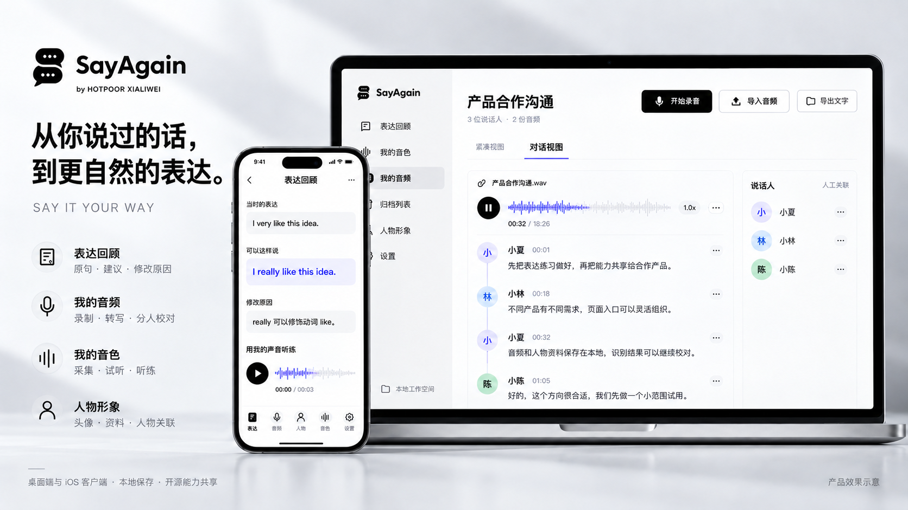

# SayAgain 产品效果图



2026-10-11 按用户提供的 SayAgain 笔记本与手机参考图制作。使用内置 `image_gen` 生成，并做一次标题间距修正；原始成图为 **1672 × 941 px**，接近 16:9。

画面保留现有双对话气泡标志、`SayAgain` 字标和 `by HOTPOOR XIALIWEI` 署名。电脑展示会话中的音频播放、候选分人、转写校对与人工人物关联；手机展示原句、建议、修改原因及已保存的听练音频。左侧归纳表达回顾、我的音频、我的音色与人物形象。

这是基于已有能力组织的**产品效果示意**，不是当前客户端的实机截图。会话内容、姓名、时长、文件数量和语音波形均为演示内容；不作为真实推理验证证据。手机画面的播放不代表手机独立完成音色克隆，两端并列也不代表自动同步已实现。

## 参考素材

- 用户在本次对话提供的产品参考图：银白色背景、笔记本主屏与手机辅屏构图。
- [现有 SayAgain 字标](../../renderer/assets/sayagain-wordmark.png)
- [现有 SayAgain 图标](../../renderer/assets/sayagain-icon.png)
- [桌面表达回顾](../screenshots/review-desktop.png)
- [iPad 表达详情](../../ios/docs/screenshots/SayAgain-iPad-review-detail-redesign.png)
- 能力依据：[项目 README](../../README.md)、[分人流程](../speaker-pipeline.md)和 [iOS 客户端](../../ios/README.md)。

画面没有采用参考图中的会议自动总结、思维导图、待办或协作分享。这些能力未作为当前 SayAgain 的已完成功能提供。

## 初次生成提示词

```text
Use case: ads-marketing / product-mockup.
Create ONE polished 16:9 landscape SayAgain product presentation image, ideally 3840x2160, using the attached reference as the visual composition guide and the actual SayAgain assets and UI references as the source of truth. This is a product effect rendering, not a screenshot of the shipped app.

Input roles:
1. User reference poster: composition, premium monochrome lighting, photorealistic silver laptop + black phone staged on a softly reflective pale gray surface, airy editorial presentation. Do not copy its fictional meeting summary/task/share features or its single-letter S icon.
2. Actual SayAgain wordmark: exact existing brand emblem and wordmark. Reproduce the black emblem consisting of TWO speech bubbles forming an S, each with three white dots. Preserve "SayAgain", with secondary creator credit "by HOTPOOR XIALIWEI".
3. Actual SayAgain icon: supporting brand invariant.
4. Actual desktop review screenshot: source of current light-gray navigation, black main actions, open white content, slim gray dividers, humane wording and current capabilities.
5. Actual iPad expression detail screenshot: source of original expression, better expression, Chinese explanation, playback and waveform structure.

Composition: luxurious but restrained, left 24% for brand and readable message, right 74% for devices. A large open modern silver laptop fills the right side; entire screen and laptop base visible, mostly frontal with subtle perspective. A black smartphone stands in front near the boundary between headline and laptop, overlapping only a little of the laptop lower-left; do not obscure main headings or conversation text. Devices are physical and photorealistic, UI screens razor-sharp. No hands, no room scene, no extra devices. Soft pale silver backdrop, diagonal diffuse light, gentle realistic shadows, subtle graphite and muted indigo waveform accents from the reference. Large professional sans-serif Chinese/English typography, excellent legibility, generous spacing. Avoid excessive glossy glow, loud gradients, nested cards, tiny dense fake words.

Poster text, exact and clearly typeset:
At upper left use supplied two-bubble SayAgain wordmark, and small "by HOTPOOR XIALIWEI".
Large Chinese headline, two or three naturally broken lines:
"从你说过的话，"
"到更自然的表达。"
Small subtitle below: "SAY IT YOUR WAY"
Four clean compact feature rows with thin monochrome icons:
"表达回顾" / "原句 · 建议 · 修改原因"
"我的音频" / "录制 · 转写 · 分人校对"
"我的音色" / "采集 · 试听 · 听练"
"人物形象" / "头像 · 资料 · 人物关联"
Bottom small neutral factual note: "桌面端与 iOS 客户端 · 本地保存 · 开源能力共享"
Bottom right very small: "产品效果示意"

LAPTOP UI: a high-fidelity design presentation grounded in the app's real capabilities, mostly white and light gray with black controls and subtle muted purple/indigo waveform.
Left navigation uses the same real two-bubble brand icon and name "SayAgain". Entries exactly: "表达回顾", "我的音色", "我的音频" (selected), "归档列表", "人物形象", "设置". Bottom text "本地工作空间".
Main page title "产品合作沟通"; subtle metadata "3 位说话人 · 2 份音频". Header buttons "开始录音" and "导入音频", small outlined "导出文字".
Tabs only "紧凑视图" and "对话视图", with dialogue selected.
An audio file group header "产品合作沟通.wav". A clean real-looking waveform with black pause button and timestamp "00:32 / 18:26". Then a vertical series of three readable conversation entries with small distinct generic circular initials avatars (not stock human portraits), clear name and timestamp and short transcript:
"小夏  00:01" / "先把表达练习做好，再把能力共享给合作产品。"
"小林  00:18" / "不同产品有不同需求，页面入口可以灵活组织。"
"小夏  00:32" / "音频和人物资料保存在本地，识别结果可以继续校对。"
Allow one additional subtle conversation entry lower down if space, no invented text.
At far right within laptop a modest narrow speaker panel, title "说话人", three initial avatars and rows "小夏", "小林", "小陈"; small label "人工关联". This is speaker filtering/profile management, not semantic meeting chapters or automatically known identities. Keep laptop content readable at poster scale. No meeting AI summaries, mind maps, action items, sharing, cloud sync, generated insights, or automatic identity recognition.

PHONE UI: an appealing authentic narrow screen adaptation of SayAgain expression review, not a clone of the desktop conversation. White background, black title "表达回顾", small back control; clear content sections:
"当时的表达"
"I very like this idea."
"可以这样说"
"I really like this idea."
"修改原因"
"really 可以修饰动词 like。"
"用我的声音听练"
A black circular play button and a delicate indigo-gray waveform, duration "00:00 / 00:03". It displays a saved practice audio result; do not claim mobile offline voice cloning. Subtle bottom navigation "表达", "音频", "人物", "音色", "设置". Use attractive clean spacing and correct Chinese and English spelling, no random gibberish.

Constraints: Present the actual product positioning: expression improvement + practice in one's own voice, with local audio and speaker organization as supporting capabilities. Maintain supplied real SayAgain branding. All dialogue content is demonstration copy. Do not add model brands, NVIDIA marketing, cloud Qwen, provider logos, App Store badges, or release promises. Produce a single cohesive photorealistic device-render + crisp graphic poster. No extra headline in English from the reference. No watermarks.
```

## 标题修正提示词

```text
Use case: precise-object-edit / text-localization. Edit this SayAgain product poster with a single local typography correction: the large Chinese headline on the upper left is partially hidden at its right edge by the smartphone. Reduce ONLY the main Chinese headline font size by approximately 12–15%, retaining the same two-line text and left alignment, so both lines including their final punctuation are fully visible with at least 20 pixels clear space before the phone. The exact headline remains "从你说过的话，" on line 1 and "到更自然的表达。" on line 2. Keep the headline bold black, professionally balanced. Do not move or change anything else: keep the supplied real two-speech-bubble SayAgain logo, creator credit, phone, laptop, device geometry, all UI content, feature labels, background lighting, shadows, footer, palette, and 16:9 canvas identical. Ensure the rightmost Chinese characters and full stop are unobscured. Preserve all correct Chinese and English text. This is only a headline fit adjustment.
```
